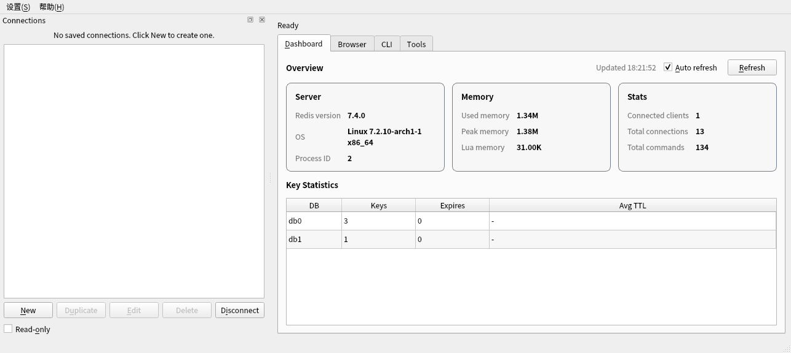
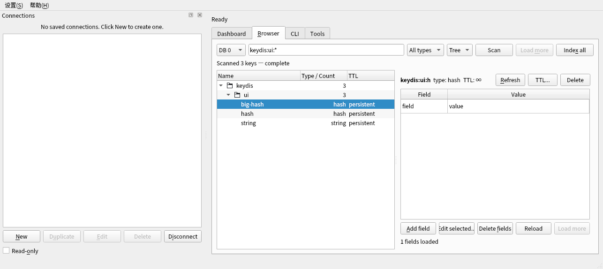

# KeyDis

> 面向 KDE 的原生 Redis / Valkey 客户端（工作名，尚未发布）

KeyDis 是一个使用 **C++20、Qt 6 Widgets 和 KDE Frameworks 6** 构建的桌面客户端，目标是在 Linux/KDE 上提供低内存、响应快、数据密集型的 Redis/Valkey 工作台。它不是 RDM / Another Redis Desktop Manager 的复刻，也不使用 Electron 或 WebView。





## 当前状态

**可用版本 0.4.11。** 已具备一个可构建、可安装的 Qt 6 + KF6 客户端：连接 Redis/Valkey、SCAN 浏览 Key、Dashboard、命名空间树、核心类型编辑、Stream/JSON、服务器工具、DUMP/RESTORE 导入导出、多连接配置与 KWallet。Sentinel、SSH key/agent 隧道与 **Cluster 基础支持** 已接入；更完整的 Cluster 运维视图仍在后续。

当前已落地：

- CMake/Ninja + Qt 6 + KF6 + hiredis v1.5.0（FetchContent 固定 tag，静态链接）；
- `KXmlGuiWindow` 主窗口、Connections Dock、Dashboard、Key 浏览器、值编辑面板、CLI；
- 命名空间树 / 平铺列表切换、DB 选择、双击命名空间按前缀过滤；
- SCAN 分页 + 类型过滤 + TTL 展示；Key 与 Hash/List/Set/ZSet 均支持 `Load more`；
- String / Hash / List / Set / ZSet 查看与部分编辑（批量选中、HMSET 回退、SETRANGE）；Stream 条目/组/Pending 查看与 claim/ack；RedisJSON 路径编辑；
- Key 右键菜单：重命名、删除、复制 Key/Value、跨连接复制；
- TTL 修改、PERSIST、UNLINK/DEL 删除；
- 只读模式禁用编辑/添加/删除与 CLI 写入；
- Dashboard：Server/Memory/Stats 卡片、Key Statistics 表、Auto refresh、双击 DB 切换；
- Tools：Slowlog、Clients、Pub/Sub、Monitor、内存分析；
- KRunner：`redis <name>` 打开已保存连接（`libkeydisrunner`）；
- RedisJSON 树形标量编辑、JSON 格式化；
- Tools → Cluster：`CLUSTER NODES` 节点/槽位快照；
- Transfer：DUMP/RESTORE JSON Lines 导出/导入，支持取消；
- 中文界面 catalog（`translations/keydis_zh_CN.ts`）；
- Arch PKGBUILD（`packaging/arch/`）；
- `Index all`：完整扫描当前 DB，使命名空间计数精确（内存换精度）；
- 多连接配置/分组、KWallet 密码、Sentinel、SSH key/agent 隧道、Cluster slot 路由、KRunner 插件、只读模式；
- 从 NutSync 复用并适配的 `AppPaths`、`Language`、`Logger`、`Diagnostics`；
- RESP2/RESP3、命令编码、语言、日志、SCAN、连接、值读写、UI 集成测试；
- 真实 Redis 7.4 集成测试与 offscreen UI 测试；
- MIT `LICENSE`、`NOTICE`、`LICENSES/`、桌面文件、AppStream、图标与安装规则。

## 快速启动

```bash
./build/keydis --host 127.0.0.1 --port 6379 --connect
```

`--host/--port/--tls/--username/--password/--db/--connect` 可直接从命令行预填并连接；`--tab dashboard|browser|cli|tools` 选择初始页。发行版打包使用 `-DKEYDIS_USE_SYSTEM_HIREDIS=ON`，避免构建时联网。

## 构建与测试

```bash
cmake -S . -B build -G Ninja -DCMAKE_BUILD_TYPE=Debug -DBUILD_TESTING=ON
cmake --build build -j2
ctest --test-dir build --output-on-failure
```

首次 configure 会通过 CMake FetchContent 拉取 hiredis v1.5.0，需要网络。

无显示环境冒烟：

```bash
QT_QPA_PLATFORM=offscreen ./build/keydis --version
```

安装到临时 prefix：

```bash
cmake --install build --prefix build/install
XDG_DATA_DIRS="$PWD/build/install/share:/usr/share" \
  QT_QPA_PLATFORM=offscreen build/install/bin/keydis --version
```

真实 Redis 集成测试：

```bash
KEYDIS_REDIS_PORT=6399 ./build/keydis_tests
KEYDIS_REDIS_PORT=6399 ./build/keydis_ui_tests
```

> 本机 Docker daemon 未运行；测试使用本地构建的 Redis 7.4.0。假服务器测试仍保留，用于 CI 与无服务器环境。

已确认的开发环境：

| 组件 | 本机版本 |
|---|---|
| Qt | 6.12.0 |
| KDE Frameworks | 6.31.0 |
| CMake | 4.4.4 |
| Ninja | 1.13.2 |
| 编译器 | GCC / Clang |
| SSH | libssh 0.12.2 |
| TLS | OpenSSL 3.6.5 |
| 压缩 | zlib 1.3.2 / zstd 1.5.7 / brotli 1.2.0 |

> Docker CLI 已安装，但当前 daemon 未运行。后续同时支持 CI 容器和本地 Redis/Valkey 实例。

## 当前范围

已完成 **v0.4 工作台**（standalone + Sentinel + SSH key/agent + Cluster 基础）。尚未实现：

- 完整 Cluster 运维视图（resharding、节点详情）；
- 精确全库命名空间统计默认关闭（可用 `Index all` 显式触发）；
- Flatpak（明确不做）；
- RedisJSON 树形控件、Cluster 运维视图。

## 目标能力

- RESP2 / RESP3，兼容 Redis 6.2–8.x 与 Valkey 7/8。
- Standalone、TLS、Unix Socket、SSH、Sentinel、Cluster、ACL。
- 基于 SCAN 的大 Key 空间浏览，默认不执行 `KEYS *`，不默认全量加载。
- String / Hash / List / Set / ZSet / Stream / RedisJSON 编辑器。
- CLI、Monitor、Pub/Sub、INFO 仪表盘、Slowlog、Clients。
- KWallet、KConfig、KXmlGui、KIO、KSyntaxHighlighting、KNotifications、KRunner 等 KDE 集成。
- 只读保护、生产环境标签、危险命令确认、批量操作预演。

## 技术路线

| 决策 | 选择 |
|---|---|
| UI | Qt Widgets + KDE Frameworks 6，不用 Kirigami/QML 做主界面 |
| 协议 | hiredis v1.5.0 reader（BSD-3-Clause）+ 自研 `RespValue` 适配层与命令编码 |
| 网络 | QTcpSocket / QSslSocket / QLocalSocket / libssh |
| 并发 | 每个 endpoint 一个 I/O 线程，命令 lane 隔离阻塞/PubSub/Monitor |
| 配置 | 版本化 JSON + KWallet；KConfig 保存应用状态 |
| 构建 | CMake + Ninja，C++20 |
| 平台 | Linux/KDE 优先，Windows/macOS 延后 |

## 文档

- [使用说明](docs/USAGE.md)
- [总体方案](docs/PLAN.md)
- [架构设计](docs/ARCHITECTURE.md)
- [阶段与路线图](docs/ROADMAP.md)
- [ADR-0001：UI 技术栈](docs/adr/0001-ui-stack.md)
- [ADR-0002：连接配置与密钥存储](docs/adr/0002-connection-storage.md)
- [ADR-0003：hiredis 协议解析](docs/adr/0003-hiredis-parser.md)
- [ADR-0004：许可证与 NutSync 复用边界](docs/adr/0004-license-and-reuse.md)
- [Arch 打包](packaging/arch/README.md)
- [翻译维护](translations/README.md)

## 设计原则

1. **SCAN-first**：不为了“看起来完整”而阻塞服务器或耗尽客户端内存。
2. **二进制安全**：键和值全程使用 `QByteArray`，显示层才做编码转换。
3. **显式写入**：编辑先进入本地撤销栈，`Apply` 才提交；不做静默覆盖。
4. **默认安全**：只读模式、TLS 校验、SSH host key 校验、秘密不落盘。
5. **KDE 原生**：遵循 KDE HIG，使用系统图标、配色、快捷键和 KF6 组件。
6. **可取消**：扫描、分析、导入导出都有进度、上限和取消入口。

## 商标与许可

- 本项目与 Redis Ltd.、Valkey 项目及 KDE e.V. 没有隶属关系。
- “Redis”“Valkey”仅用于描述兼容性，不用于产品名。
- KeyDis 使用 **MIT** 许可证；hiredis 为 BSD-3-Clause，Qt/KF6 为 LGPL 动态链接。
- 直接复用 NutSync 的 AppPaths/Language/Logger/Diagnostics；原代码为 `GPL-3.0-or-later`，由版权人重新许可为 MIT，provenance 记录在 `NOTICE`。
- NutSync 的 AUR 打包文件为 `0BSD`，可参考/复用。
- 应用 ID 暂定 `io.github.keydis.KeyDis`，正式发布前替换为实际反域名。
